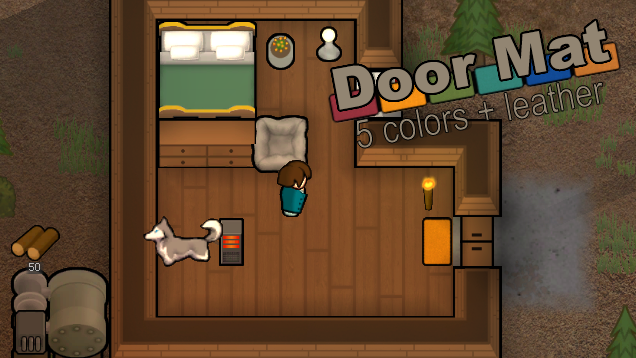

# Door Mat for RimWorld 1.7

**An unofficial, vibe-coded port of Dracoix's Door Mat, originally created by Latta.**

[](https://github.com/joesobo/RimWorld-DoorMat/actions/workflows/build.yml)

Door Mat adds small and large mats that help keep pawns from tracking dirt through your colony. This repository adapts the existing mod for **RimWorld 1.7.4985-unstable** and shares the code so other players can use it, inspect it, or learn from the changes.

The 1.7 port was made by **joesobo with OpenAI Codex**. "Vibe-coded" means the port was developed with AI assistance. The original mod, its artwork, and its gameplay design belong to their respective creators. Please support [Latta](https://github.com/alattalatta/RimWorld-DoorMat) and [Dracoix](https://steamcommunity.com/sharedfiles/filedetails/?id=1505423207), whose work made this possible.

This is a small community project, shared at no charge. No payment is expected, and no Steam Workshop publication is planned. It is independent of the original authors and Ludeon Studios.



*Preview artwork from the upstream mod; this is not a new screenshot of the 1.7 port.*

## Status and requirements

| Item | Details |
| --- | --- |
| Game version | RimWorld **1.7.4985 rev1269**, on the unstable branch |
| In-game status | joesobo installed the port on Windows and reported that it worked on **October 24, 2026** |
| Dependencies | RimWorld Core; no DLC or Harmony dependency |
| Scope of testing | Initial success reported; the full manual checklist and save migration remain unverified |

Other 1.7 builds and mod combinations may behave differently. This package does not target RimWorld 1.6 or earlier. See [testing notes](docs/TESTING.md) for the distinction between automated checks and in-game testing.

## Install

You do **not** need to compile the mod or install the .NET SDK to play.

1. Download the existing **[DoorMat-1.7.zip test archive](https://github.com/joesobo/RimWorld-DoorMat/releases/download/v1.7.0-test.1/DoorMat-1.7.zip)**. It contains the compiled mod and its source. This archive predates the documentation refresh; the current instructions are here in the repository.
2. Find your RimWorld installation. In Steam, right-click **RimWorld → Manage → Browse local files**.
3. Extract the archive's `DoorMat-1.7` folder into the game's `Mods` folder. The layout should be:

   ```text
   RimWorld/
   └── Mods/
       └── DoorMat-1.7/
           ├── About/
           │   └── About.xml
           ├── Assemblies/
           │   └── RimWorld-DoorMat.dll
           ├── Defs/
           └── Textures/
   ```

4. Open **Mods** in RimWorld. Disable any other version of Door Mat, then enable **Door Mat (1.7 Vibecoded Port)** after Core.
5. Apply the mod list and restart the game. For your first test, use a new colony or a copy of an existing save.

The port shares the original `dracoix.doormat.r12a` package ID, so enable **only one version of Door Mat at a time**. It also preserves the original `LT.*` building names. That is intended to retain existing mats, but save migration has not been confirmed.

If you prefer the current repository files, use **Code → Download ZIP**, extract it, and copy the folder containing `About`, `Assemblies`, `Defs`, and `Textures` into `Mods`. The repository includes a compiled DLL; GitHub's source ZIP is not the same archive as the test download above.

## Use in game

- Open **Architect → Misc** to find the small and large doormats.
- Place mats where pawns already walk, such as entrances and busy corridors. Rotate them as needed.
- Material-based mats accept fabric or leather. The colored cloth variants require **Carpet making** research.
- Pawns crossing or standing on a mat try to deposit carried filth there. Filth that cannot be deposited stays with the pawn.
- Mats slowly clean themselves and nearby cells. They can still become dirty in busy areas, so ordinary cleaning remains useful.

The port keeps the original textures, construction costs, and cleaning behavior. Its changes focus on compatibility with 1.7 and safer handling of pawns, changing cell contents, and map edges. The [development guide](docs/DEVELOPMENT.md) describes those changes.

## Troubleshooting

| Problem | What to check |
| --- | --- |
| Mod does not appear | Confirm `Mods/DoorMat-1.7/About/About.xml` exists. An extra nested folder is a common cause. |
| Duplicate package warning | Disable the Workshop version and any other local copy of Door Mat. |
| Mats are missing from the build menu | Restart after enabling the mod, look under **Misc**, and check **Carpet making** research for colored cloth mats. |
| Mats look dirty | They collect filth and clean slowly; they do not instantly erase all dirt. |
| Errors or unexpected behavior | Try Core and this port in a new test colony, then add other mods back to narrow down the cause. |

Bug reports and improvements are welcome through [GitHub Issues](https://github.com/joesobo/RimWorld-DoorMat/issues) or pull requests. Include your exact game version, relevant mods, steps to reproduce, and the relevant error text. Remove personal information from logs before sharing them. This is a personal project, so fixes and future game updates are handled as time allows.

## Credits and reuse

- **Latta** — original [LT-DoorMat](https://github.com/alattalatta/RimWorld-DoorMat).
- **Dracoix** — [Door Mat maintenance and updates through 1.6](https://steamcommunity.com/sharedfiles/filedetails/?id=1505423207).
- **ignis** — filth-dropping support credited in Dracoix's source.
- **Upstream artists and translators** — the inherited artwork and translations.
- **joesobo, with OpenAI Codex** — this unofficial 1.7 compatibility port.
- **Krafs** — [RimRef](https://github.com/krafs/RimRef), the build reference package.

You are welcome to use this port for free and inspect the source. joesobo's original contributions are offered under the MIT terms in [LICENSE.md](LICENSE.md). That permission applies to those contributions; it does not relicense the original authors' code, artwork, or other inherited material. See [CREDITS.md](CREDITS.md) for provenance and attribution.

For building, validation, and packaging, see [docs/DEVELOPMENT.md](docs/DEVELOPMENT.md).
